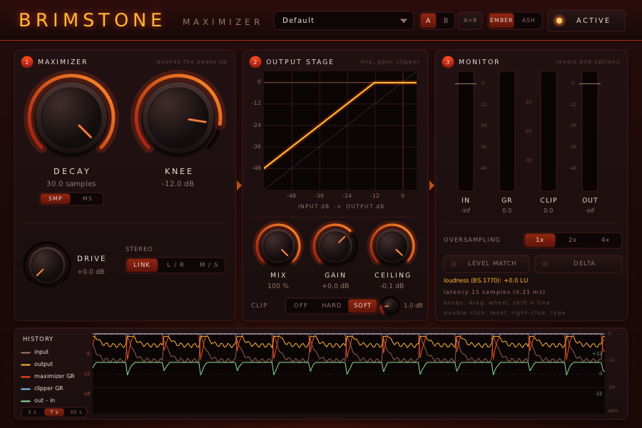
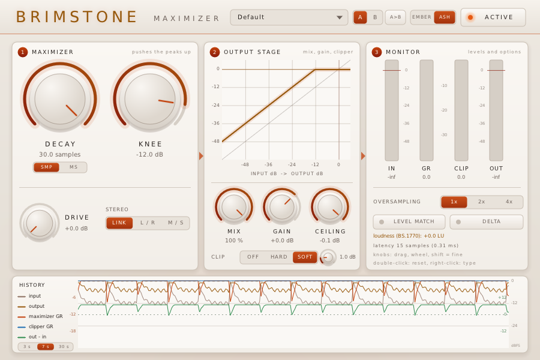

# Brimstone Maximizer

Maximiseur de crêtes, équivalent du « Barry's Satan Maximiser » (`satan_maximiser`, LADSPA,
swh-plugins de Steve Harris), réécrit en C++ avec DPF, interface NanoVG.
Formats : VST3 et CLAP pour Windows 64 bits ; VST3, CLAP et LV2 pour Linux.
**Licence : GPL 2 ou ultérieure** (`COPYING`), comme l'original ; DPF est sous ISC (compatible).

**Manuel d'utilisation** (réglages, préréglages, description détaillée de l'algorithme avec
figures) : `doc/manuel.pdf` ; source `doc/manuel.tex` (pdflatex ×3 dans `doc/`), figures
`doc/figures.py` (mêmes formules que le DSP).

## Algorithme
Cœur identique à l'original :
- enveloppe : attaque instantanée, décroissance de `1/decay` par échantillon ;
- gain = 1 / max(enveloppe, knee) : toute crête au-dessus du knee est ramenée au plafond ;
- anticipation de round(decay/2) échantillons.

Avec le préréglage « Original (swh) » (unité échantillons, 1x, Clip Off, Ceiling 0 dB, Drive 0,
Stereo L/R, Mix 100 %, Gain 0), la sortie est celle de l'original retardée de 15 échantillons
(test 1 : écart relatif ≤ 1,2e-7).

Dénormaux : sur un silence, l'enveloppe reste sur le plus petit nombre dénormal, lent sur x86 ;
`run` active FTZ/DAZ et rétablit l'état du FPU de l'hôte en sortie (silence 2 à 3 fois moins
coûteux quand l'hôte les laisse coupés ; sortie inchangée au-dessus de -400 dB).

Chaîne (fréquence interne = fréquence de l'hôte × suréchantillonnage) :
entrée → suréchantillonnage → Drive → cœur → × Ceiling, mélange avec le signal sec → Gain →
écrêtage au plafond → sous-échantillonnage → écrêtage de sûreté → Level match → Bypass.

## Réglages
| Réglage | Rôle |
|---|---|
| Decay | 2-30 échantillons (unité d'origine : à l'échelle de l'hôte, même en 2x/4x) ou 0,05-2 ms (même son à toute fréquence) ; bouton SMP/MS, conversion à la bascule |
| Knee | -90..0 dB ; au-dessus, crêtes ramenées au plafond |
| Drive | 0..24 dB, gain d'entrée du seul signal traité |
| Ceiling | -12..0 dB, niveau de sortie maximal |
| Clip | Off (original : la sortie peut dépasser le plafond, jusqu'à +7 dB pour un Decay de 3 échantillons, +4,4 dB pour 30 ; manuel § 7.2), Hard, Soft (linéaire jusqu'au soft knee puis épaule en tanh jusqu'au plafond) |
| Soft knee | 0,1-6 dB sous le plafond : début de l'arrondi en Soft (petit bouton à droite de Clip, grisé hors Soft). Crête poussée au plafond par le maximiseur : -0,23 dB à 1 dB, -0,45 dB à 2 dB, -0,87 dB à 4,44 dB (60 % du plafond, la valeur fixe d'avant le 2026-11-25). Préréglages : 1 dB (Default, Loud master), 2 dB (Subtle), 4,44 dB (Wide crush, caractère gardé) ; sans effet dans les autres (Off ou Hard) |
| Stereo | Link (détecteur commun), L/R (chaque canal : l'original), M/S |
| Mix | sec/traité ; à 0 % le maximiseur est hors circuit (écrêteur pur) |
| Gain | -24..+12 dB après le mélange, avant l'écrêtage : pousse les crêtes au-dessus du plafond (s'appelait Output) |
| Oversampling | 1x, 2x, 4x (demi-bandes FIR, Kaiser β = 8 : 107 coefficients pour l'étage à la fréquence de Nyquist de l'hôte, plat à 0,01 dB jusqu'à 20 kHz et ≥ 80 dB au-delà de 24,2 kHz à 44,1 kHz ; 47 pour le second étage du 4x ; 47 partout avant le 2026-11-25 : -2 dB à 20 kHz, 19 dB de rejet à 24,1 kHz) |
| Level match | compense le gain de sonie pour comparer avec Bypass à sonie égale ; sonie selon ITU-R BS.1770 (pondération K : plateau de +4 dB au-dessus de ~1,7 kHz et passe-haut RLB à ~38 Hz ; moyenne quadratique sur ~1,5 s, sans fenêtrage) ; l'écart est affiché en LU (« loudness (BS.1770) ») |
| Delta | fait entendre ce que le maximiseur et l'écrêteur changent : sortie moins la même chaîne sans réduction ni écrêtage (gain du maximiseur tenu à 1/knee, mêmes filtres de suréchantillonnage, donc sans le gain de compensation) ; sans Level match ; fondu de 10 ms ; Bypass prioritaire ; non enregistré dans les préréglages |
| Bypass | paramètre Bypass déclaré à l'hôte ; entrée retardée de la latence, fondu de 10 ms |

Latence déclarée à l'hôte, fixe pour une unité et un facteur donnés : 15 échantillons (échantillons, 1x),
68 (2x), 80 (4x) ; en ms à 44,1 kHz : 44, 97, 109 (38, 50 ; 67, 79 avant les filtres de 107
coefficients du 2026-11-25). Changer l'unité ou le suréchantillonnage change la
latence et remet l'état à zéro (court silence).

Changement de Decay sans clic : quand round(decay/2) change, un second détecteur (enveloppe et
historique des gains) démarre avec la nouvelle anticipation et les gains sont fondus en 5 ms ;
chaque détecteur reste cohérent, donc ni clic ni dépassement (test 5).

Préréglages d'usine : Default, Original (swh), Subtle, Loud master, Wide crush, Destruction,
Clipper (liste déroulante en haut de l'interface, aussi exposés à l'hôte ; « * » si modifié).
Préréglages de l'utilisateur : enregistrés depuis l'interface, communs à tous les projets et à
tous les hôtes (voir « Interface »).

Écrêteur pur (préréglage Clipper) : Mix 0 % court-circuite le cœur du maximiseur ; le signal
d'origine passe par Gain (de combien on pousse, +3 dB dans le préréglage), puis par l'écrêtage
au plafond (Hard, -0,3 dB), en 4x. Plafond garanti sur les échantillons, pas sur les crêtes
entre échantillons.

## Interface
900 × 600, redimensionnable (proportions gardées), HiDPI. Trois sections numérotées, de gauche à
droite dans l'ordre du signal (flèches entre elles) :
1. **MAXIMIZER** : Decay (et son unité), Knee, Drive, Stereo ; grisée avec la mention
   « OFF: mix at 0 % » quand Mix est à 0 % ;
2. **OUTPUT STAGE** : courbe de transfert, Mix, Gain, Ceiling, Clip ;
3. **MONITOR** : vu-mètres IN, GR (maximiseur, 0 quand Mix = 0 %), CLIP (écrêteur), OUT ;
   Oversampling, Level match, Delta, écart de sonie, latence.

**Historique** (3, 7 ou 30 s au choix sous la légende, 7 s par défaut ; un point toutes les 25 ms, crêtes des 30 dernières ms, donc aucune crête
perdue entre deux points) : crêtes *input*, *maximizer* (entrée de l'écrêteur, après maximiseur, Mix
et Gain, à la cadence interne, bornée à +12 dBFS ; sortie `hist_max` du DSP, ajoutée le
2026-11-26) et *output* (sortie du greffon : avec Delta, la différence ; après Level match et
Bypass), chacune masquable d'un clic sur sa légende ; pointillés : plafond. **Échelle dBFS automatique** (graduée à droite) sur les courbes
affichées et la durée affichée : le bas descend aussitôt sous le niveau le plus faible (pas de
6 dB, 1 dB de marge, au plus -90 dBFS ; en dessous : silence, ignoré) et ne remonte que quand ce
niveau est à plus de 3 dB du pas supérieur (pas de battement) ; le haut est 0 dBFS, ou le
multiple de 6 dB au-dessus quand une courbe dépasse 0 dBFS (maximizer poussé par Gain, Clip Off) ; 12 dB au moins ;
graduations multiples de 6, 12 ou 24 dB selon l'étendue. Session 68 : vue des gains (réductions,
out - in) essayée puis retirée à la demande de l'utilisateur, avec les sorties `hist_gr` et
`hist_clip` du DSP.

La durée et le choix des courbes affichées sont enregistrés avec le projet (état DPF `history`,
`seconds=<3|7|30>;show=<un 0/1 par courbe>`, input, output puis maximizer (ordre d'ajout, pas
celui de la légende) ; un état plus court laisse visibles les courbes manquantes) ; nouvelle instance : 7 s, toutes visibles. La courbe de transfert
donne le niveau de sortie pour un niveau d'entrée stable, tous réglages compris (Mix aussi).
**Préréglages** (2026-11-25, remplace les flèches < >) : liste déroulante de l'en-tête, en deux
sections séparées par un trait, FACTORY (usine) puis USER (les vôtres, par ordre alphabétique),
puis « Save current settings... ». Clic : ouvre la liste, le préréglage courant est marqué d'un
point ; clic sur un nom : le charge ; clic ailleurs ou Échap : ferme sans rien changer ; molette
sur la boîte fermée : suivant ou précédent (usine puis utilisateur, en boucle) ; liste plus haute
que la fenêtre : défile à la molette.
- **Enregistrer** : « Save current settings... », puis taper le nom dans la boîte (proposé : le
  nom du préréglage de l'utilisateur en cours), Entrée : enregistre, Échap ou clic ailleurs :
  annule. Une bulle dit ce que fera Entrée : enregistrer, remplacer un préréglage du même nom
  (casse ignorée), ou refuser (nom d'un préréglage d'usine, nom invalide pour Windows, écriture
  impossible). Noms : 1 à 24 caractères ASCII imprimables, sans `< > : " / \ | ? *`.
- **Supprimer** : croix à droite d'un préréglage de l'utilisateur survolé ; premier clic :
  « delete? », second clic : supprime (sans retour en arrière).
- **Fichiers** : un fichier `<nom>.preset` par préréglage dans `presets/`, à côté de
  `brimstone.conf` (`%APPDATA%\Brimstone\presets\`, `~/.config/brimstone/presets/`) ; lignes
  `clé=valeur` lisibles (`decay`, `decay_ms`, `decay_unit`, `knee`, `drive`, `ceiling`, `clip`,
  `stereo`, `mix`, `gain`, `oversampling`, `match` ; Bypass exclu), nombres en point décimal quelle
  que soit la locale de l'hôte ; clé absente : valeur par défaut, valeur hors bornes : ramenée
  dans les bornes, ligne inconnue : ignorée. Copier un fichier suffit à partager un préréglage.
  Le fichier est relu au chargement et la liste à chaque ouverture : un préréglage enregistré
  dans une instance apparaît dans les autres. Le désinstalleur laisse ces fichiers.
- L'hôte ne voit que les préréglages d'usine (liste de DPF fixée à la compilation) ; ses propres
  préréglages (par exemple `.vstpreset`) restent possibles et indépendants.
Code : `plugin/BrimstoneUserPresets.hpp` (fichiers), `BrimstoneUI.cpp` (liste, saisie du nom).

**Comparaison A/B** (en-tête, à droite des préréglages) : deux jeux de réglages ; clic sur A
ou B : bascule (le jeu quitté est gardé, celui rejoint est rechargé ; à la première visite, B
part d'une copie de A) ; bouton A>B (ou B>A) : copie le jeu courant dans l'autre. Avec Level
match, compare deux réglages à sonie égale. Enregistré avec le projet : le jeu actif est l'état
des paramètres, l'autre est l'état DPF `ab` (`slot=<0|1>;other=<13 valeurs>`, nombres en point
décimal) ; le préréglage d'origine du jeu inactif n'est pas gardé dans le projet (affiché
« Set A » ou « Set B » à la réouverture). Bypass et Delta n'en font pas partie.
**RANDOM** (en-tête, entre la pastille de thème et Bypass, à la place du FREEZE de Tinplate) :
tire au hasard les 13 réglages d'un préréglage (`randomize`, `std::mt19937` semé par
`std::random_device`) : valeurs continues uniformes sur toute leur plage, arrondies comme
l'affichage des boutons (Mix à 1 %, Decay en ms à 0,01, les autres à 0,1) ; sélecteurs (unité de
Decay, Clip, Stereo, Oversampling, Level match) : une de leurs positions au hasard. Bypass et
Delta ne changent pas. Une seule action, sans état ; le préréglage affiché devient « Random ».
Drive et Gain pouvant sortir forts, la bulle d'aide conseille de copier d'abord le jeu courant
dans l'autre (A>B). Pour lui faire place (2026-11-27), la boîte des préréglages est passée de 196
à 170 points (nom trop long abrégé par « ... », l'astérisque toujours visible), A/B, copie et thème
se sont décalés, Bypass est passé à 98 points et l'espacement de « MAXIMIZER » de 5 à 4.
**Bulle d'aide sur chaque élément** (boutons, sélecteurs, vu-mètres, courbe, préréglages, Bypass).
Boutons : glisser verticalement (Maj : fin), molette, double-clic ou Ctrl+clic : défaut,
**clic droit : saisie au clavier** (Entrée, Échap).
**Thèmes** : Ember (sombre, d'origine) et Ash (clair : papier cendré, encre anthracite, mêmes
orange brûlé et ocre), bascule par la pastille EMBER | ASH de l'en-tête, sans effet sur le son.
Le choix est une **préférence de l'utilisateur**, commune à toutes les instances et à tous les
projets, non enregistrée avec le projet (décision du 2026-11-24) : fichier `brimstone.conf`
(`theme=ember` ou `theme=ash`) dans `%APPDATA%\Brimstone\` (Windows) ou
`$XDG_CONFIG_HOME/brimstone/`, à défaut `~/.config/brimstone/` (Linux) ; fichier absent ou
illisible : Ember ; écriture impossible : le choix vaut jusqu'à la fermeture de la fenêtre.
Les autres fenêtres ouvertes changent à leur réouverture. Le désinstalleur laisse ce fichier.
Couleurs : structure `Theme` de `BrimstoneUI.cpp` (une instance par thème) ; lecture et écriture
du fichier : `plugin/BrimstonePrefs.hpp`.

Captures : `-DBRIMSTONE_UI_DEMO=<zone>` (et `_PRESET=<n>`) force une bulle d'aide et un préréglage
dans une version de démonstration, `-DBRIMSTONE_UI_DEMO_MENU=<n>` ouvre la liste des préréglages,
souris sur la ligne n (titres et traits comptés, à partir de 0 ; `-DBRIMSTONE_UI_DEMO_ARM=1` :
croix déjà cliquée une fois), `-DBRIMSTONE_UI_DEMO_NAME='"texte"'` montre la saisie d'un nom ;
jamais dans `build.sh`. Préréglages de l'utilisateur dans les captures : préfixe Wine dédié
(`WINEPREFIX=...`), rempli par `tests/test_user_presets.cpp` compilé avec MinGW.

## Compiler
`./build.sh` (Linux, MinGW-w64 `-posix`, git) :
1. clone DPF au commit testé (`4238e1c`) et applique `patches/` ;
2. tests du DSP (`tests/test_dsp.cpp`) ;
3. Windows → `bin/windows/`, Linux → `bin/linux/` ;
4. installateur Windows (`installer/brimstone.nsi`) si `makensis` est présent (`apt install nsis`)
   → `bin/Brimstone-Maximizer-1.2.0-setup.exe` (VST3 imposé, CLAP et manuel PDF en option, cochés
   par défaut ; le manuel va dans `Program Files\Brimstone\Brimstone-Maximizer-manuel.pdf`, avec un
   raccourci dans le menu Démarrer pour tous les utilisateurs). Le PDF n'est pas refait par
   `build.sh` : recompiler `doc/manuel.tex` avant si le manuel a changé.

Installation manuelle sous Windows : copier `bin/windows/brimstone_maximizer.vst3` (le dossier entier)
dans `C:\Program Files\Common Files\VST3\`, `brimstone_maximizer.clap` dans `...\Common Files\CLAP\`.

`./build.sh windows` : Windows seulement.

## Correctif de DPF
`patches/dpf-vst3-flush-parameters.patch` : DPF ignorait les changements de paramètres d'un appel
`process` sans audio (« flush », permis par VST3) ; le validateur de Steinberg échouait (Bypass non
resynchronisé après rechargement d'un préréglage). Correctif à proposer à DPF.

## Vérifications
- `tests/test_dsp.cpp` (43 cas, dont l'état du FPU rétabli après `run` et Delta : nul sur une
  chaîne linéaire en 1x et 4x, égal à ce que retire l'écrêteur avec Clipper, Bypass prioritaire ;
  soft knee : sortie exacte en 1x de 0,1 à 6 dB ; sonie : coefficients de la pondération K à
  48 kHz égaux à ceux de la norme à 1e-15, gain pur de +6 dB lu +6,0 LU ; états de l'interface
  déclarés, gardés et rendus) : original, plafond (1x/2x/4x, Hard/Soft), Bypass exact,
  latence en 2x/4x (écart ≤ 1,6e-5 sur un sinus de 1 kHz), changements de Decay, préréglages,
  écrêteur pur, mesures (réductions du maximiseur et de l'écrêteur, crêtes d'entrée et de sortie
  de l'historique).
- Banc de CPU (`tests/bench_cpu.cpp`, hors `build.sh`, commande en tête du fichier) : ns par
  trame stéréo et charge d'une instance, 1x/2x/4x, musique, silence, Bypass, FTZ/DAZ coupés ou
  non. Mesures : `AMELIORATIONS.md` (H, A).
- Validateur VST3 de Steinberg (`tools/validate_vst3.sh`) : 47/47 sur le VST3 Linux, 47/47 sur
  le VST3 Windows (validateur compilé avec MinGW, lancé sous Wine). Relancé le 2026-11-25 après
  l'ajout des états (A/B, historique), Delta et Soft knee : 47/47 sur le VST3 Linux ; Windows non
  relancé. Les messages « assertion failure » de DPF sur la sortie d'erreur (paramètres de sortie
  absents, indices invalides envoyés exprès par le validateur) sont les mêmes avant et après.
- `tests/test_prefs.cpp` (7 cas, lancé par `build.sh` dans un dossier personnel vide) : fichier
  absent, écriture et relecture des deux thèmes, valeur invalide, lignes inconnues et fins CRLF.
  Vérifié aussi : `XDG_CONFIG_HOME`, `HOME` absent (écriture refusée sans erreur), Windows sous
  Wine, y compris un `APPDATA` accentué.
- `tests/test_user_presets.cpp` (17 cas, lancé par `build.sh` dans le même dossier vide, sous une
  locale à virgule décimale `fr_FR.UTF-8`) : noms valides et refusés (caractères, espaces et
  points, noms réservés de Windows, longueur, noms d'usine), écriture et relecture exactes,
  liste triée sans casse, remplacement d'un nom de casse différente, suppression, fichier écrit
  à la main (clés absentes, inconnues, hors bornes, CRLF), autres fichiers ignorés. Lancé aussi
  sous Wine (compilé avec MinGW : `_wfindfirst`, `APPDATA`).
- Interface affichée par la version autonome Windows sous Wine, thèmes Ember et Ash (captures
  ci-dessus ; l'historique y est synthétique, faute d'audio sous Wine) ; liste des préréglages
  ouverte (avec préréglages de l'utilisateur et croix armée) et saisie d'un nom vues
  (2026-11-25).
- Installateur (NSIS 3.09) : installation et désinstallation silencieuses (`/S`) sous Wine :
  VST3 (identique à `bin/windows/`), CLAP, licence, entrée « Programmes » du registre, puis tout retiré.
  Refait le 2026-11-25 avec le manuel (préfixe Wine neuf) : PDF identique à `doc/manuel.pdf`,
  raccourci dans `ProgramData\...\Start Menu\Programs\Brimstone Maximizer\`, puis tout retiré.
- Non vérifié : chargement dans un vrai logiciel audio Windows ; installateur en mode graphique
  et sur un vrai Windows ; interactions de l'interface (seul l'affichage a été vu ; clic sur
  la pastille de thème, la liste des préréglages, l'enregistrement et la suppression compris ;
  saisie au clavier dans un vrai hôte : certains hôtes gardent le clavier pour eux) ; macOS. Validateur VST3 non relancé après les thèmes (interface seule).

Améliorations : voir `AMELIORATIONS.md`.

## Pour reprendre
- Dépôt git dans ce dossier (créé en session 64), distant `origin` =
  `git@github.com:tterraz-vibe-audio/brimstone_maximizer.git` (ajouté par l'utilisateur le 2026-11-25 ;
  transféré du compte `tterraz` à l'organisation `tterraz-vibe-audio` le 2026-11-27, l'ancienne adresse redirige ;
  `master` poussé et suivi ; push sur demande, auteur et committer Claude) ; `dpf/`, `build*/`, `bin/` non suivis (`dpf/`
  est un clone de DPF portant le correctif de `patches/`, refait par `build.sh`).
- `./build.sh` refait tout (tests, Windows, Linux, installateur si `makensis`).
- Validateur de Steinberg : `tools/validate_vst3.sh DOSSIER [windows]` (clone le SDK dans DOSSIER ;
  sous Wine, préfixe propre `DOSSIER/wineprefix`).
- Captures de l'interface : options passées par la variable d'environnement `CXXFLAGS`
  (`-DBRIMSTONE_UI_DEMO=-1 -DBRIMSTONE_UI_DEMO_THEME=1` : thème forcé, jamais enregistré ;
  `BUILD_DIR_SUFFIX` distinct par variante) ; version autonome Windows (`make -C plugin jack ...` avec les variables
  MinGW de `build.sh`) lancée sous Wine, puis `import -window` sur la fenêtre « Brimstone: ... » ;
  `-DBRIMSTONE_UI_DEMO=<zone>` (`-1` : aucune) et `-DBRIMSTONE_UI_DEMO_PRESET=<n>` forcent une bulle
  d'aide, un préréglage et un historique synthétique. Vérifier que la fenêtre existe avant
  `import`, sinon c'est l'écran entier qui est pris. La fenêtre s'ouvre sur l'affichage de
  l'utilisateur (pas d'Xvfb) ; une variante par capture (`BUILD_DIR_SUFFIX=-demo-<n>`) ;
  les captures gardées sont dans `doc/captures/` (LISEZMOI et manuel).
- Sous Wine, `APPDATA` est fixé par Wine (`drive_c/users/<nom>/AppData/Roaming`) : une valeur
  donnée depuis Linux est ignorée ; pour essayer un autre dossier, `_wputenv` dans le programme.
- Captures avec préréglages de l'utilisateur, liste ouverte ou saisie d'un nom :
  `-DBRIMSTONE_UI_DEMO_MENU=<ligne>` (`_ARM=1`), `-DBRIMSTONE_UI_DEMO_NAME='"texte"'`,
  `-DBRIMSTONE_UI_DEMO_HIST=<0|1|2>` (3, 7, 30 s) ; lancer la version autonome avec
  `WINEPREFIX=<préfixe dédié>` rempli par `tests/test_user_presets.cpp` compilé avec MinGW (jamais
  le `~/.wine` de l'utilisateur).
- Manuel : `python3 doc/figures.py` puis `pdflatex manuel.tex` ×3 dans `doc/` (retirer les
  `.aux/.log/.toc/.out`) ; à refaire avant `build.sh` si le manuel change (l'installateur le
  reprend tel quel). Les chiffres du manuel (dépassement, réponse des filtres, latences, CPU)
  ont été vérifiés sur le greffon : les revérifier si le DSP change.
- Banc CPU : comparer deux versions en les lançant en même temps sur deux cœurs
  (`taskset -c 2` / `-c 5`), deux tours en croisant les cœurs ; la machine de l'utilisateur est
  souvent chargée (valeurs absolues au simple au triple), seuls les rapports simultanés valent.
- 2e série d'`AMELIORATIONS.md` terminée le 2026-11-25 (A-D, F-H, J), puis K (filtre 2x à 107
  coefficients), un commit par point.
- Reste : essais dans un vrai hôte (clics et saisie au clavier : liste des préréglages,
  enregistrement d'un nom, A/B, durée de l'historique, pastille de thème ; rechargement d'un
  projet avec ses états A/B et historique) ; validateur VST3 Windows à relancer ; correctif à
  proposer à DPF.
- **Releases GitHub** (seule la dernière est gardée, étiquettes gardées ; `v1.1.0` supprimée le 2026-11-27) :
  `v1.1.0` (2026-11-25, première publique), `v1.2.0` (2026-11-27 : courbe
  *maximizer*, RANDOM ; fichiers dans `build/release-1.2.0/`). Procédure : `./build.sh` complet sur
  `master` propre ; fichiers assemblés dans `build/release/` (non suivi) : installateur
  `bin/Brimstone-Maximizer-1.1.0-setup.exe`, `Brimstone-Maximizer-1.1.0-windows.zip` (VST3, CLAP),
  `Brimstone-Maximizer-1.1.0-linux-x86_64.tar.gz` (VST3, CLAP, LV2), chacun avec `COPYING` et le manuel, et le manuel
  seul `Brimstone-Maximizer-manuel.pdf` ; notes en anglais (`build/release/notes.md` : téléchargements,
  installation, essais faits et non faits, licence) ; étiquette annotée `v1.1.0` (auteur Claude) poussée,
  puis `/usr/bin/gh release create v1.1.0 --repo tterraz-vibe-audio/brimstone_maximizer --title ... --notes-file notes.md <fichiers>`
  (`gh` hors du PATH du bac à sable, déjà connecté au compte `tterraz`). Avant : captures de
  `doc/captures/` refaites si l'interface a changé, manuel recompilé, validateur VST3 Linux
  (47/47), installation silencieuse (`/S`) sous Wine dans un préfixe neuf. **La version 1.2.0 est
  publiée** : tout changement livré ensuite demande un nouveau numéro (`getVersion`, installateur,
  documents ; choix de l'utilisateur).
- 1.2.0 (2026-11-27) : courbe *maximizer* de l'historique (`18797c9`, point L
  d'`AMELIORATIONS.md`) et bouton RANDOM (`9f2cdbc`, point M) ; captures refaites (légende à
  trois courbes, nouvel en-tête). RANDOM vu à l'écran sous Wine (en-tête, bulle d'aide), tirage
  non essayé au clic (aucun clic automatisé possible ici). Zone de bulle d'aide RANDOM : 118
  (`-DBRIMSTONE_UI_DEMO=118`). Captures de la liste : préréglage 2, `_MENU=10`, `_ARM=1` (Ember)
  et `_NAME='"bright"'` (Ash), recadrées x 300-630 (420 + 140 points de haut) et empilées.
- Version : restée 1.1.0 malgré les ajouts du 2026-11-25 (décision de l'utilisateur : le
  logiciel n'avait jamais été utilisé), puis publiée telle quelle. Les réglages des projets sont
  relus par symbole : ajouter un paramètre plus tard ne casse pas un projet.
