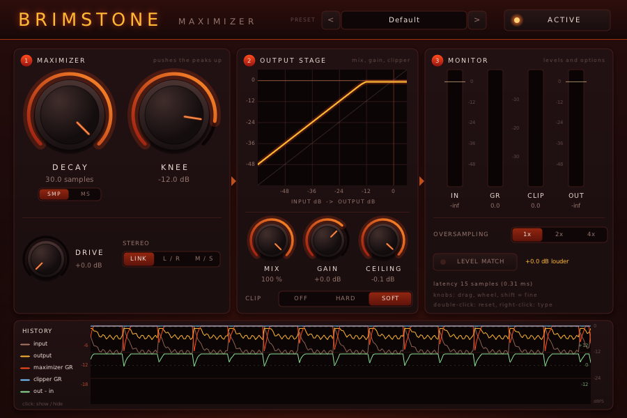

# Brimstone Maximizer

Maximiseur de crêtes, équivalent du « Barry's Satan Maximiser » (`satan_maximiser`, LADSPA,
swh-plugins de Steve Harris), réécrit en C++ avec DPF, interface NanoVG.
Formats : VST3 et CLAP pour Windows 64 bits ; VST3, CLAP et LV2 pour Linux.
**Licence : GPL 2 ou ultérieure** (`COPYING`), comme l'original ; DPF est sous ISC (compatible).

## Algorithme
Cœur identique à l'original :
- enveloppe : attaque instantanée, décroissance de `1/decay` par échantillon ;
- gain = 1 / max(enveloppe, knee) : toute crête au-dessus du knee est ramenée au plafond ;
- anticipation de round(decay/2) échantillons.

Avec le préréglage « Original (swh) » (unité échantillons, 1x, Clip Off, Ceiling 0 dB, Drive 0,
Stereo L/R, Mix 100 %, Gain 0), la sortie est celle de l'original retardée de 15 échantillons
(test 1 : écart relatif ≤ 1,2e-7).

Chaîne (fréquence interne = fréquence de l'hôte × suréchantillonnage) :
entrée → suréchantillonnage → Drive → cœur → × Ceiling, mélange avec le signal sec → Gain →
écrêtage au plafond → sous-échantillonnage → écrêtage de sûreté → Level match → Bypass.

## Réglages
| Réglage | Rôle |
|---|---|
| Decay | 2-30 échantillons (unité d'origine : à l'échelle de l'hôte, même en 2x/4x) ou 0,05-2 ms (même son à toute fréquence) ; bouton SMP/MS, conversion à la bascule |
| Knee | -90..0 dB ; au-dessus, crêtes ramenées au plafond |
| Drive | 0..24 dB, gain d'entrée du seul signal traité |
| Ceiling | -12..0 dB, niveau de sortie maximal |
| Clip | Off (original : la sortie peut dépasser 0 dBFS, jusqu'à +6 dB), Hard, Soft (linéaire jusqu'à 60 % du plafond puis épaule en tanh) |
| Stereo | Link (détecteur commun), L/R (chaque canal : l'original), M/S |
| Mix | sec/traité ; à 0 % le maximiseur est hors circuit (écrêteur pur) |
| Gain | -24..+12 dB après le mélange, avant l'écrêtage : pousse les crêtes au-dessus du plafond (s'appelait Output) |
| Oversampling | 1x, 2x, 4x (demi-bandes FIR 47 coefficients, ~80 dB de réjection) |
| Level match | compense le gain de sonie (RMS ~1,5 s) pour comparer avec Bypass à niveau égal ; l'écart est affiché (« LOUDER ») |
| Bypass | paramètre Bypass déclaré à l'hôte ; entrée retardée de la latence, fondu de 10 ms |

Latence déclarée à l'hôte, fixe pour une unité et un facteur donnés : 15 échantillons (échantillons, 1x),
38 (2x), 50 (4x) ; en ms à 44,1 kHz : 44, 67, 79. Changer l'unité ou le suréchantillonnage change la
latence et remet l'état à zéro (court silence).

Changement de Decay sans clic : quand round(decay/2) change, un second détecteur (enveloppe et
historique des gains) démarre avec la nouvelle anticipation et les gains sont fondus en 5 ms ;
chaque détecteur reste cohérent, donc ni clic ni dépassement (test 5).

Préréglages : Default, Original (swh), Subtle, Loud master, Wide crush, Destruction, Clipper
(sélecteur en haut de l'interface, aussi exposés à l'hôte ; « * » si modifié).

Écrêteur pur (préréglage Clipper) : Mix 0 % court-circuite le cœur du maximiseur ; le signal
d'origine passe par Gain (de combien on pousse, +3 dB dans le préréglage), puis par l'écrêtage
au plafond (Hard, -0,3 dB), en 4x. Plafond garanti sur les échantillons, pas sur les crêtes
entre échantillons.

## Interface
900 × 600, redimensionnable (proportions gardées), HiDPI. Trois sections numérotées, de gauche à
droite dans l'ordre du signal (flèches entre elles) :
1. **MAXIMIZER** : Decay (et son unité), Knee, Drive, Stereo ; grisée avec la mention
   « OFF: mix at 0 % » quand Mix est à 0 % ;
2. **OUTPUT STAGE** : courbe de transfert, Mix, Gain, Ceiling, Clip ;
3. **MONITOR** : vu-mètres IN, GR (maximiseur, 0 quand Mix = 0 %), CLIP (écrêteur), OUT ;
   Oversampling, Level match et écart de sonie, latence.

**Historique** (~7 s, un point toutes les 25 ms, crêtes des 30 dernières ms, donc aucune crête
perdue entre deux points), cinq courbes fines sur une même bande, chacune masquable d'un clic sur
sa légende :
- *input*, *output* : niveaux de crête, montent depuis le bas (dBFS, échelle à droite ; pointillés : plafond) ;
- *maximizer GR*, *clipper GR* : réductions, descendent depuis le haut (dB, échelle à gauche) ;
- *out - in* : gain total réellement appliqué, sortie moins entrée (dB, échelle centrée sur 0,
  graduée dans le graphique à droite ; interrompue quand l'entrée est muette).

Le choix des courbes affichées n'est pas enregistré avec le projet (toutes visibles à l'ouverture). La courbe de transfert
donne le niveau de sortie pour un niveau d'entrée stable, tous réglages compris (Mix aussi).
**Bulle d'aide sur chaque élément** (boutons, sélecteurs, vu-mètres, courbe, préréglages, Bypass).
Boutons : glisser verticalement (Maj : fin), molette, double-clic ou Ctrl+clic : défaut,
**clic droit : saisie au clavier** (Entrée, Échap).
Captures : `-DBRIMSTONE_UI_DEMO=<zone>` (et `_PRESET=<n>`) force une bulle d'aide et un préréglage
dans une version de démonstration ; jamais dans `build.sh`.

## Compiler
`./build.sh` (Linux, MinGW-w64 `-posix`, git) :
1. clone DPF au commit testé (`4238e1c`) et applique `patches/` ;
2. tests du DSP (`tests/test_dsp.cpp`) ;
3. Windows → `bin/windows/`, Linux → `bin/linux/` ;
4. installateur Windows (`installer/brimstone.nsi`) si `makensis` est présent (`apt install nsis`)
   → `bin/Brimstone-Maximizer-1.1.0-setup.exe`.

Installation manuelle sous Windows : copier `bin/windows/brimstone_maximizer.vst3` (le dossier entier)
dans `C:\Program Files\Common Files\VST3\`, `brimstone_maximizer.clap` dans `...\Common Files\CLAP\`.

`./build.sh windows` : Windows seulement.

## Correctif de DPF
`patches/dpf-vst3-flush-parameters.patch` : DPF ignorait les changements de paramètres d'un appel
`process` sans audio (« flush », permis par VST3) ; le validateur de Steinberg échouait (Bypass non
resynchronisé après rechargement d'un préréglage). Correctif à proposer à DPF.

## Vérifications
- `tests/test_dsp.cpp` (26 cas) : original, plafond (1x/2x/4x, Hard/Soft), Bypass exact,
  latence en 2x/4x (écart ≤ 1,6e-5 sur un sinus de 1 kHz), changements de Decay, préréglages,
  écrêteur pur, mesures (réductions du maximiseur et de l'écrêteur, crêtes de l'historique).
- Validateur VST3 de Steinberg (`tools/validate_vst3.sh`) : 47/47 sur le VST3 Linux, 47/47 sur
  le VST3 Windows (validateur compilé avec MinGW, lancé sous Wine).
- Interface affichée par la version autonome Windows sous Wine (capture ci-dessus ; l'historique y
  est synthétique, faute d'audio sous Wine).
- Installateur (NSIS 3.09) : installation et désinstallation silencieuses (`/S`) sous Wine :
  VST3 (identique à `bin/windows/`), CLAP, licence, entrée « Programmes » du registre, puis tout retiré.
- Non vérifié : chargement dans un vrai logiciel audio Windows ; installateur en mode graphique
  et sur un vrai Windows ; interactions de l'interface (seul l'affichage a été vu) ; macOS.

Améliorations : voir `AMELIORATIONS.md`.

## Pour reprendre
- Dépôt git dans ce dossier (créé en session 64) ; `dpf/`, `build*/`, `bin/` non suivis (`dpf/`
  est un clone de DPF portant le correctif de `patches/`, refait par `build.sh`).
- `./build.sh` refait tout (tests, Windows, Linux, installateur si `makensis`).
- Validateur de Steinberg : `tools/validate_vst3.sh DOSSIER [windows]` (clone le SDK dans DOSSIER ;
  sous Wine, préfixe propre `DOSSIER/wineprefix`).
- Captures de l'interface : version autonome Windows (`make -C plugin jack ...` avec les variables
  MinGW de `build.sh`) lancée sous Wine, puis `import -window` sur la fenêtre « Brimstone: ... » ;
  `-DBRIMSTONE_UI_DEMO=<zone>` (`-1` : aucune) et `-DBRIMSTONE_UI_DEMO_PRESET=<n>` forcent une bulle
  d'aide, un préréglage et un historique synthétique. Vérifier que la fenêtre existe avant
  `import`, sinon c'est l'écran entier qui est pris.
- Reste : voir `AMELIORATIONS.md` (essais sur un vrai Windows, correctif à proposer à DPF).
- Défaut connu, non changé : dans Default (Soft), l'écrêteur arrondit toujours ~1 dB, car il
  commence à 60 % du plafond alors que le maximiseur pousse les crêtes au plafond.
