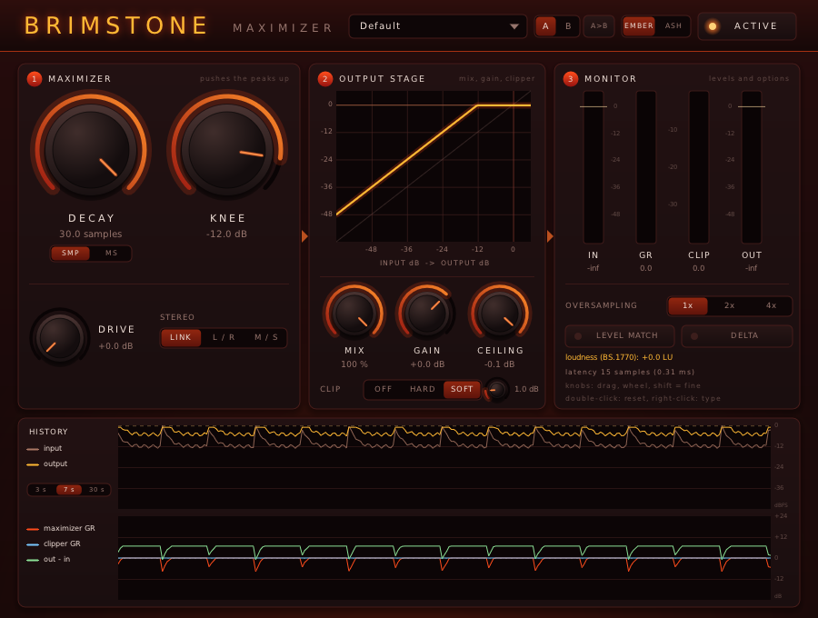
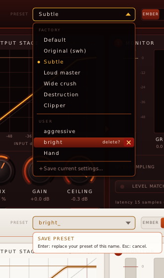

# Brimstone Maximizer

A brutal peak maximizer for VST3, CLAP and LV2, built around the algorithm of Steve Harris'
**Barry's Satan Maximiser** (LADSPA `satan_maximiser`, swh-plugins), with what a modern
mastering or mixing tool needs around it: output ceiling, hard or soft clipper, oversampling,
dry/wet mix, stereo modes, delta listening, loudness-matched comparison and presets.



## Features

- **Original core**: instant attack, `1 / max(envelope, knee)` gain, short lookahead of half the
  decay. With the *Original (swh)* preset the output is the original one, sample for sample
  (delayed by the latency).
- **Decay** in samples (original unit) or in milliseconds (same sound at any sample rate),
  changed without clicks (two detectors crossfaded over 5 ms).
- **Knee**, **Drive** (into the maximizer only), **Mix**, **Gain**, **Ceiling**.
- **Clipper**: Off (original behaviour), Hard, or Soft with an adjustable **soft knee**.
- **Stereo**: linked, independent L/R (original) or mid/side.
- **Oversampling** 1x / 2x / 4x: linear-phase half-band FIR filters, flat to 20 kHz and more than
  80 dB of rejection above 24.2 kHz (host at 44.1 kHz).
- **Level match**: loudness after ITU-R BS.1770 (K-weighting), to compare with Bypass at equal
  loudness; the loudness change is shown in LU.
- **Delta**: listen to what the maximizer and the clipper change (makeup gain removed).
- **A/B comparison** of two sets of settings, saved with the project.
- **Presets**: 7 factory presets, and your own presets (save, replace, delete) shared by all
  projects and hosts.
- **Meters**: input, maximizer and clipper gain reduction, output; transfer curve; a 3, 7 or 30 s
  history in two plots on one time axis: levels (dBFS) and gains (reductions, output minus input; dB).
- Resizable HiDPI interface with tooltips everywhere, dark (Ember) and light (Ash) themes;
  keyboard entry of values (right-click a knob).
- Bypass declared to the host, latency reported, no denormal slowdown in silence.



## Formats

| Platform | Formats |
|---|---|
| Windows 64-bit | VST3, CLAP (installer included) |
| Linux x86-64 | VST3, CLAP, LV2 |

macOS is not built (no macOS machine available); the code is portable (DPF).

## Installation

**Windows**: run `Brimstone-Maximizer-1.1.0-setup.exe` (VST3, optional CLAP and user manual).
Manually: copy the `brimstone_maximizer.vst3` folder to `C:\Program Files\Common Files\VST3\` and
`brimstone_maximizer.clap` to `C:\Program Files\Common Files\CLAP\`.

**Linux**: copy `brimstone_maximizer.vst3` to `~/.vst3/`, `brimstone_maximizer.clap` to
`~/.clap/` or `brimstone_maximizer.lv2` to `~/.lv2/`.

User settings (theme) and user presets are stored in `%APPDATA%\Brimstone\` (Windows) or
`$XDG_CONFIG_HOME/brimstone/`, by default `~/.config/brimstone/` (Linux).

## Documentation

- **User manual** (French): [`doc/manuel.pdf`](doc/manuel.pdf): every setting, the presets and a
  detailed description of the algorithm with its equations (envelope and anticipation, overshoot
  without clipper, soft clipper, oversampling filters, latency, delta, BS.1770 loudness),
  illustrated by figures computed with the same formulas as the DSP (`doc/figures.py`).
- Developer notes (French): [`LISEZMOI.md`](LISEZMOI.md); history of the improvements:
  [`AMELIORATIONS.md`](AMELIORATIONS.md).

## Building

Everything is built from Linux (Windows binaries are cross-compiled with MinGW-w64):

```sh
./build.sh            # tests, Windows (VST3, CLAP), Linux (VST3, CLAP, LV2), installer
./build.sh windows    # tests and Windows only
```

`build.sh` clones [DPF](https://github.com/DISTRHO/DPF) at the tested commit (`4238e1c`), applies
the fix in `patches/`, runs the tests and writes the plugins to `bin/windows/` and `bin/linux/`.

Requirements (Debian/Ubuntu names): `git`, `g++`, `make`, `pkg-config`, X11 and OpenGL development
files (`libx11-dev`, `libgl-dev`; DPF also uses `libxcursor-dev`, `libxext-dev`, `libxrandr-dev`
when present), `g++-mingw-w64-x86-64-posix` for Windows, and optionally `nsis` for the installer.
The manual needs `python3-numpy`, `python3-matplotlib` and `pdflatex`:

```sh
cd doc && python3 figures.py && pdflatex manuel.tex && pdflatex manuel.tex && pdflatex manuel.tex
```

## Tests

- `tests/test_dsp.cpp` (43 checks, run by `build.sh`): identity with the original algorithm,
  ceiling at 1x/2x/4x, exact bypass, latency and frequency response of the oversampling, click-free
  decay changes, presets, clipper, meters, denormals, delta, soft knee, BS.1770 coefficients,
  plugin states.
- `tests/test_prefs.cpp`, `tests/test_user_presets.cpp`: preferences and user preset files
  (including a locale with a decimal comma).
- `tests/bench_cpu.cpp`: CPU bench (about 0.2 %, 0.7 % and 1.2 % of one core per instance at 1x,
  2x and 4x on an Intel i7-8665U at 44.1 kHz).
- `tools/validate_vst3.sh`: Steinberg's VST3 validator (47/47 on Linux).

The fix in `patches/dpf-vst3-flush-parameters.patch` makes DPF apply parameter changes sent in a
VST3 `process` call without audio (a "flush"), which the VST3 validator checks.

## Licence

GPL 2.0 or later (see [`COPYING`](COPYING)), like the original swh-plugins. DPF is under the ISC
licence.

## Credits

Original algorithm: Steve Harris, *Barry's Satan Maximiser* (swh-plugins).
Plugin framework and UI toolkit: [DPF](https://github.com/DISTRHO/DPF) by Filipe Coelho.
K-weighting: ITU-R BS.1770-4, sample-rate independent coefficients after libebur128.
